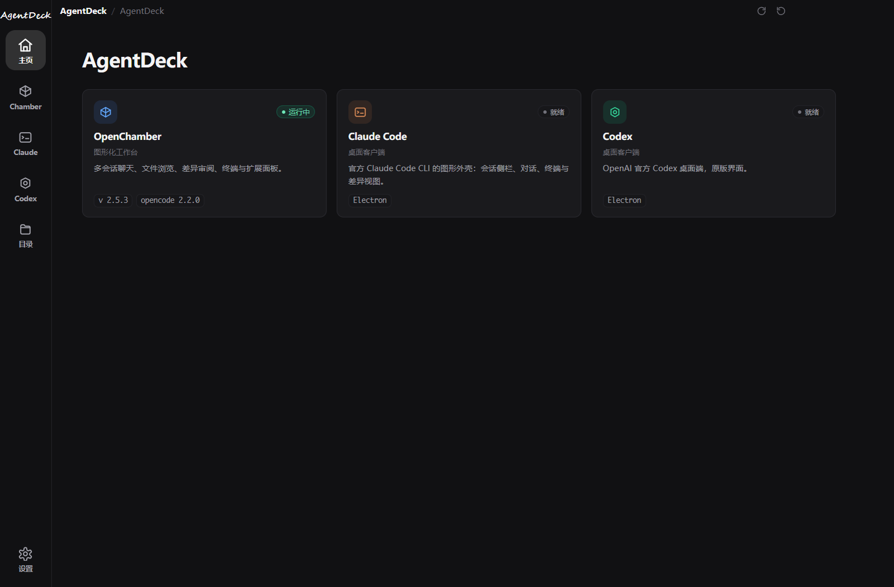

# AgentDeck

Three AI coding agents in one self-contained Windows window: **OpenChamber**,
**Claude Code** and **Codex** — plus a sandboxed execution environment for the
agents themselves.

No installer, no runtime to fetch, nothing to install first. The app ships the
whole stack, including a microVM runtime.



## What it does

| Panel | What runs there |
|---|---|
| **OpenChamber** | Its own web UI in an embedded `WebContentsView`, served by a bundled server against a bundled `opencode.exe` |
| **Claude Code** | The official Claude Desktop app, in its own process, in third-party deployment mode |
| **Codex** | The official OpenAI Codex desktop app, in its own process |
| **沙盒 (Sandbox)** | The agent execution environment: kernel status, live process table, and a command board |

Each panel is the vendor's own application. Nothing is reimplemented and no UI is
mocked — the three front ends are the real binaries.

## The sandbox

Agents can run their commands inside a Linux microVM instead of on Windows. The
runtime is bundled (Docker Sandboxes, ~560 MB, 13 files), starts its own
hypervisor-isolated VM through Windows' Hypervisor Platform, and needs no
installed service, no driver, and no WSL.

Measured capabilities inside it:

```
kernel      7.0.14 x86_64 (Docker Hardened Images / Debian 13)
cpu         4 cores, 8 GB
isolation   0 host mounts, C:\ absent, seccomp on, zero Linux capabilities, non-root
workspace   one host directory, mounted over virtiofs
toolchain   Python 3.13, Node 20, GCC 14, Go 1.24, Rust 1.85
```

The panel reports these from the guest kernel itself — not from configuration —
and the same page carries a live `/proc` process table and a command board.

## Command board

Every command the app runs in a sandbox is recorded with **proof of where it ran**:
the kernel release, the PID and network namespace ids, whether `C:\` is visible,
and the uid. A record whose proof does not check out is not shown as verified.

Two kinds of record, deliberately labelled apart:

| Badge | Meaning |
|---|---|
| **已验证** | Started by the app. Has kernel proof and an exit code. |
| **沙盒内观测** | Started inside the sandbox by an agent. Recorded by a shim in front of every binary; no kernel proof, no exit code. |

The board refreshes live, keeps your scroll position and open rows across
refreshes, and supports multi-word search (all terms must match) plus filters.

### Why a shim, and not kernel tracing

Low-overhead kernel observation was investigated and measured, and it is not
available here:

| Approach | Result |
|---|---|
| eBPF tracepoint | A socket filter loads, but tracepoint and raw-tracepoint programs fail with `EINVAL` — this kernel has `CONFIG_BPF_EVENTS` off |
| ftrace / tracefs | tracefs is absent; root cannot mount it either |
| perf | Not installed, and `perf_event_paranoid = 2` would refuse it |
| strace | Works, but traps every syscall — far too expensive to leave on |

So the recorder is a shim: one script plus a symlink for every executable in the
image. Cost is one extra exec per command, measured at about **3.5 ms**, and it
needs no kernel facilities.

## Customisation

All three agents extend through **MCP**. The app renders one definition into each
app's native format:

| Target | File | Shape |
|---|---|---|
| Claude Code | `%LOCALAPPDATA%\Claude-3p\claude_desktop_config.json` | JSON, `mcpServers` |
| Codex | `%USERPROFILE%\.codex\config.toml` | TOML, `[mcp_servers.<name>]` |
| OpenCode | `%USERPROFILE%\.config\opencode\opencode.jsonc` | JSONC, `mcp.servers.<name>` |
| Sandbox agents | `%LOCALAPPDATA%\DockerSandboxes\sandboxes\state\agent-skills` | one folder per skill |

Only Claude's config is written automatically, because it is plain JSON this app
already owns. Codex owns its TOML, OpenCode's config is JSONC with hand-written
comments that a round-trip would delete, and the skills folder is a directory
structure — those are shown as text to place yourself.

The full guide ships inside the app, at `app/docs/CUSTOMIZE.md`.

## How the panels work

Setting a child window with `SetParent` was the obvious approach and it failed.
Measured on the real windows, converting a guest to `WS_CHILD` left it painting
nothing at all, and Chromium's compositor does not take kindly to having its
window reclassified.

The panels are therefore **owned windows**: `GWLP_HWNDPARENT` is set to the host
window, the caption and resize frame are dropped, and the window is placed over
the slot the renderer reports. An owned window stays a top-level window, so the
guest renders exactly as it does when launched on its own, while Windows keeps it
above the owner, out of the taskbar, and hidden when the owner is minimised.

Three things had to be discovered the hard way:

- Guests must **not** be spawned with `windowsHide: true`. That starts the child
  with `STARTF_USESHOWWINDOW + SW_HIDE`, and an Electron app then creates its
  window hidden and never shows it — measured: it stayed at `visible=false` for
  45 seconds that way, and appeared within 1 second without it.
- Guests must **not** be given `WS_EX_TOOLWINDOW`. Measured on the official Codex
  app, setting that bit makes the app re-hide its own window: `ShowWindow`
  succeeds and `IsWindowVisible` still reports false a second later.
- Showing a window once is **not enough**. Codex shows and then hides itself again
  within a few hundred milliseconds, so the display call is repeated until
  `IsWindowVisible` actually reports true. Re-entering a panel after leaving it
  hits the same path — the first version only positioned the window on a return
  visit and never re-showed it, which left the panel blank.

Placement is then checked rather than assumed: the window rect, the slot and the
display scale are compared after every switch, and the log records `posOK`,
`sizeOK` and `visible`.

## Requirements

Windows 10 or 11, x64, with **Windows Hypervisor Platform** enabled (needed by the
sandbox, not by the app itself). The sandbox also needs one Docker account sign-in
(`sbx login`); the check is server-side and cannot be packaged around.

## Building

```powershell
node app/scripts/make-icons.js      # regenerate the icon set
node scripts/package.js             # produce dist/AgentDeck/
node scripts/verify.js              # 34 checks on the finished bundle
```

`scripts/package.js` also stamps the executable's icon and version resource, and
runs the sanitisation steps described below.

## Sanitisation

A packaged app inherits whatever the build machine had. The build removes, in
order:

- the vendored front end's own analytics key, blanked to `""` so no event is sent
  to a third party;
- this machine's account name, which `rustc` bakes into compiled Tauri binaries as
  absolute crate paths;
- debug logs and patch backups left beside the guest executables.

Each step is part of the build, not a manual cleanup, so a rebuild cannot
reintroduce them.

Credentials never travel in the bundle: the anthropic shim reads its key from an
environment variable, and Codex's provider block is written into the *user's*
`~/.codex/config.toml` at configure time.

## Licences

The bundled applications keep their own licences; see `LICENSES.chromium.html`,
`LICENSE`, and each vendor directory under `resources/app/vendor`. Docker
Sandboxes is redistributed unmodified under its own terms.
